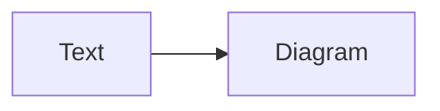

# DSH Lesbare Diagramme

> Ein Diagramm statt einer Textwand – gezeichnet, wo der Text stand.

## Was es tut

DeepSeek Harness stellt Markdown im Chat bereits dar. Dieses Plugin fügt genau eines hinzu: Enthält eine Antwort einen `mermaid`-Codeblock, zeichnet der Chat ihn an genau dieser Stelle als Diagramm – in der Nachricht, im Lauf der Unterhaltung. Daneben öffnet sich kein Fenster, nichts wechselt in eine Seitenleiste.

Der Codeblock wird nie verbraucht. Er bleibt der Text der Nachricht: kopierbar, weitergebbar und auch dann noch lesbar, wenn dieses Plugin entfernt ist (Suchen ist nicht verifiziert: siehe G7).

## Warum es so gebaut ist

- **Der Text ist die Aufzeichnung.** Jedes Diagramm wird beim Anzeigen aus dem Codeblock neu erzeugt; nichts existiert nur als Pixel. Plugin aus – die Unterhaltung bleibt vollständig.
- **In der Nachricht, nicht daneben.** Ein Vorschaufenster zerreißt den Lesefaden: Man verliert die Zeile, bei der man war.
- **Können gehört zum Plugin, Vorliebe zu dir.** Das Plugin sagt nur, dass hier Diagramme erscheinen. Ob der Assistent zeichnen soll, entscheidest du, und es braucht dafür keine geänderte Anweisungsdatei.
- **Über deinen Rechner wird nichts angenommen.** Die Zeichen-Engine ist mitgeliefert, das Plugin arbeitet offline und verlangt nichts vom Host.

## Was du bekommst

- Diagramme an Ort und Stelle für `mermaid`-Codeblöcke: Flussdiagramm, Sequenz, Klasse, Zustand, ER, Mindmap, Zeitachse und weitere vom Motor unterstützte Diagrammtypen; die statische Prüfung tastet diese sieben ab, der Browser-Test zeichnet nur die ersten beiden (weitere Typen sind ungetestet, siehe G21).
- **Quelle anzeigen** und **Quelle kopieren** unter jedem Diagramm – der Text hinter dem Bild ist einen Klick entfernt.
- Während eine Antwort noch streamt, bleibt der Block ein Codeblock; das Diagramm erscheint, sobald der Block vollständig ist.
- Ein nicht auswertbarer Block zeigt den ursprünglichen Codeblock plus eine Zeile mit dem Grund – nie einen leeren Rahmen.
- Farben und Schriften folgen dem Oberflächenthema; ein Themenwechsel wird ohne Neuladen übernommen.
- Auf dem Telefon oder in einem schmalen Fenster passt sich das Diagramm der Spaltenbreite an, und der Zoom bleibt im Diagramm – die Seite scrollt nie seitwärts.
- Acht Oberflächensprachen, dieselben, die DeepSeek Harness mitbringt.
- Zur Laufzeit wird nichts geladen: Die Engine steckt im Plugin.

## Daten und Datenschutz

- Das Plugin stellt zur Laufzeit keine Netzwerkanfragen; die Zeichen-Engine ist in `client.js` gebündelt.
- Es sammelt nichts und sendet nichts irgendwohin.
- Es liest nur den Text des `mermaid`-Codeblocks, der bereits auf deiner Seite angezeigt wird, und schreibt nur das Diagramm in diese Seite.
- Die Schaltfläche **Quelle kopieren** nutzt die Zwischenablage deines Browsers; nichts verlässt die Seite.
- Deinem Sitzungsverlauf wird nichts hinzugefügt: Das Diagramm ist eine Darstellung, kein gespeichertes Objekt (reale Maschine nicht geprüft: siehe G12).

## So überprüfst du es

Voraussetzungen: Node.js 22 oder neuer sowie Chrome/Chromium für die Browser-Prüfungen.

- `node verify/check-bundle.mjs` – statische und Engine-Prüfungen des ausgelieferten Pakets (Manifest, keine Netzwerkaufrufe, keine Versionsschwelle, die mitgelieferte Engine, acht Oberflächensprachen, sieben Beispieldiagramme). Gibt pro Prüfung eine Zeile aus und beendet sich bei Fehlschlag mit einem Wert ungleich null.
- `node verify/run-harness.mjs` – führt die Browser-Prüfungen im Headless-Chrome gegen `verify/harness/index.html` aus (Zeichnen, acht Sprachen, ungünstige Hosts, fehlerhafte Diagramme, Kopieren, schmale 360-px-Spalte, Themenfarben). Setze `DSH_DYSLEXIA_CHROME` auf eine bestimmte Chrome-Programmdatei, falls die automatische Erkennung fehlschlägt.

Beide Befehle liegen im Repository, sodass sich die Aussagen in dieser Datei jederzeit erneut prüfen lassen; dieselben Prüfungen führt auch die CI vor der Veröffentlichung aus.

## Bekannte Grenzen

- **Hier verifiziert:** Zeichnen im Chat in DSH Desktop `0.2.2-rc.5` (Plugin `0.1.2`, echte Geräteprüfung nur für die chinesische Dokumentationsseite) verifiziert; Beschriftungs-Fallback verifiziert; Deinstallations-Fallback und Neuinstallation verifiziert; acht Oberflächensprachen im Headless-Test verifiziert; schmale 360-px-Spalte verifiziert.
- **Wahrscheinlich, aber auf deinem Rechner nicht bewiesen:** andere DSH-Versionen; andere Chromium-basierte Browser; dieselben Prüfungen auf Mobilgeräten (das Layout ist in einem 360-px-Viewport eines Desktop-Browsers verifiziert, nicht auf einem physischen Telefon); sehr große Diagramme (es gibt Grenzen: 24 KiB Quelltext, 2 MiB Zeichenausgabe, 400 Kanten; darüber hinaus fällt es auf den Codeblock zurück).
- **Nicht durchgeführt:** ein DSH-Upgrade wurde noch nie geprobt (siehe G1); Diagramme werden nicht gezeichnet, solange eine Nachricht noch streamt; nur ` ```mermaid `-Blöcke werden behandelt (keine anderen Codeblock-Sprachen).

## Installation

Installiere das Paket `@jiezhengj/dsh-dyslexia` in deinem DeepSeek-Harness-Profil (Plugin-Seite); es zeichnet Diagramme im Gespräch, sobald es installiert ist (auf einem echten Rechner geprüft). Das Deinstallieren wurde in einer laufenden Oberfläche beobachtet: Abbildung und Schaltflächen verschwinden, die Nachricht zeigt wieder ihren ursprünglichen Codeblock, die Historie bleibt unverändert. Aktivieren und Deaktivieren laufen über den Plugin-Mechanismus des Hosts, ohne dass eine Konfigurationsdatei angefasst wird, **wurden aber nicht getrennt beobachtet** (siehe G20). Bei einem Versionswechsel muss die App neu starten, damit der neue Client-Code geladen wird. Auf npm: https://www.npmjs.com/package/@jiezhengj/dsh-dyslexia

## Beispiel

Eine Antwort enthält diesen Block, und der Chat zeigt ihn als Bild:



## Deinstallation und Kompatibilität

- Eine Deinstallation lässt jede frühere Unterhaltung unversehrt: Frühere Diagramme werden wieder zu den Codeblöcken, aus denen sie entstanden, lesbar.
- Das Plugin deklariert keine Versionsschwelle und kein erforderliches Host-Paket; eine Versionsprüfung den Start also nicht ablehnen kann; ein echtes Host-Update wurde noch nicht geprobt (siehe G1). Ändert sich die Form des Hosts, tritt das Plugin zurück und der ursprüngliche Codeblock wird gezeigt.

## Lizenz

MIT. Die mitgelieferte Zeichen-Engine Pele 1.13.0 steht ebenfalls unter MIT; siehe `THIRD-PARTY-NOTICES.md`.

Quellcode: https://github.com/jiezhengj/DSH-Dyslexia

Andere Sprachen: [English](README.en.md) · [简体中文](README.zh.md) · [日本語](README.ja.md) · [Español](README.es.md) · [Français](README.fr.md) · [Русский](README.ru.md) · [Português](README.pt.md)
