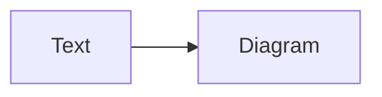

# DSH Lesbare Diagramme

> Ein Diagramm statt einer Textwand – gezeichnet, wo der Text stand.

## Was es tut

DeepSeek Harness stellt Markdown im Chat bereits dar. Dieses Plugin fügt genau eines hinzu: Enthält eine Antwort einen `mermaid`-Codeblock, zeichnet der Chat ihn an genau dieser Stelle als Diagramm – in der Nachricht, im Lauf der Unterhaltung. Daneben öffnet sich kein Fenster, nichts wechselt in eine Seitenleiste.

Der Codeblock wird nie verbraucht. Er bleibt der Text der Nachricht: kopierbar, durchsuchbar, weitergebbar und auch dann noch lesbar, wenn dieses Plugin entfernt ist.

## Warum es so gebaut ist

- **Der Text ist die Aufzeichnung.** Jedes Diagramm wird beim Anzeigen aus dem Codeblock neu erzeugt; nichts existiert nur als Pixel. Plugin aus – die Unterhaltung bleibt vollständig.
- **In der Nachricht, nicht daneben.** Ein Vorschaufenster zerreißt den Lesefaden: Man verliert die Zeile, bei der man war.
- **Können gehört zum Plugin, Vorliebe zu dir.** Das Plugin sagt nur, dass hier Diagramme erscheinen. Ob der Assistent zeichnen soll, ist deine Anweisung in deiner eigenen `AGENTS.md`.
- **Über deinen Rechner wird nichts angenommen.** Die Zeichen-Engine ist mitgeliefert, das Plugin arbeitet offline und verlangt nichts vom Host.

## Was du bekommst

- Diagramme an Ort und Stelle für `mermaid`-Codeblöcke: Flussdiagramm, Sequenz, Klasse, Zustand, ER, Mindmap, Zeitachse und die übrigen Diagrammtypen von Mermaid 12.1.
- **Quelle anzeigen** und **Quelle kopieren** unter jedem Diagramm – der Text hinter dem Bild ist einen Klick entfernt.
- Während eine Antwort noch streamt, bleibt der Block ein Codeblock; das Diagramm erscheint, sobald der Block vollständig ist.
- Ein nicht auswertbarer Block zeigt den ursprünglichen Codeblock plus eine Zeile mit dem Grund – nie einen leeren Rahmen.
- Farben und Schriften folgen dem Oberflächenthema; ein Themenwechsel wird ohne Neuladen übernommen.
- Auf dem Telefon oder in einem schmalen Fenster passt sich das Diagramm der Spaltenbreite an, und der Zoom bleibt im Diagramm – die Seite scrollt nie seitwärts.
- Acht Oberflächensprachen, dieselben, die DeepSeek Harness mitbringt.
- Zur Laufzeit wird nichts geladen: Die Engine steckt im Plugin.

## Installation

Installiere das Paket `@jiezhengj/dsh-dyslexia` in deinem DeepSeek-Harness-Profil (Plugin-Seite) und starte die App neu. Auf npm: https://www.npmjs.com/package/@jiezhengj/dsh-dyslexia

## Beispiel

Eine Antwort enthält diesen Block, und der Chat zeigt ihn als Bild:

## Deinstallation und Kompatibilität

- Eine Deinstallation lässt jede frühere Unterhaltung unversehrt: Frühere Diagramme werden wieder zu den Codeblöcken, aus denen sie entstanden, lesbar und durchsuchbar.
- Das Plugin deklariert keine Versionsschwelle und kein erforderliches Host-Paket; ein Host-Update kann den Start der App daher nicht verhindern. Ändert sich die Form des Hosts, tritt das Plugin zurück und der ursprüngliche Codeblock wird gezeigt.

## Lizenz

MIT. Die mitgelieferte Zeichen-Engine Pele 1.13.0 steht ebenfalls unter MIT; siehe `THIRD-PARTY-NOTICES.md`.

Quellcode: https://github.com/jiezhengj/DSH-Dyslexia

Andere Sprachen: [English](README.en.md) · [简体中文](README.zh.md) · [日本語](README.ja.md) · [Español](README.es.md) · [Français](README.fr.md) · [Русский](README.ru.md) · [Português](README.pt.md)
