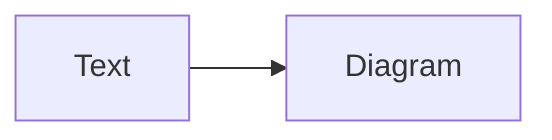

# DSH — I'm dyslexic

> A diagram instead of a wall of text — drawn where the text is.

## What it does

DeepSeek Harness already renders Markdown in a chat. This plugin adds one thing: when a reply contains a `mermaid` code block, the chat draws it as a diagram right there — inside the message, in the flow of the conversation. No window opens beside it, nothing switches to a side panel.

The code block is never consumed. It stays in the message as text: it can be copied, sent on, and read after this plugin is gone (searching is not verified: see feature 001's E-GAPS, G7).

## Why it is built this way

- **The text is the record.** Every drawing is made from the code block when it is shown, so nothing lives only as pixels. Turn the plugin off and the conversation is still complete.
- **Inside the message, not beside it.** A preview window breaks the thread of reading: you lose the line you were on.
- **The plugin asks for a picture when a picture is easier.** When a diagram makes a reply easier to follow than a paragraph, the plugin now says so to the assistant and keeps the text for what the picture cannot show. Settings → General has a switch; turn it off and the plugin goes back to rendering only.
- **Nothing about your machine is assumed.** The drawing engine is bundled, the plugin works offline, and it asks nothing of the host.

## What you get

- Diagrams in place for `mermaid` code blocks: flowcharts, sequence, class, state, ER, mind map, timeline, and other diagram types the vendored engine supports; the static check samples these seven and the browser fixture draws the first two only (see feature 001's E-GAPS, G21).
- **Show source** and **Copy source** under every drawing, so the text behind the picture is one click away.
- While a reply is streaming, the block stays a code block; the drawing appears when the block is complete.
- A block that cannot be parsed shows the plain code block plus one line saying why — never an empty frame.
- Colours and fonts follow the interface theme, and a theme switch is picked up without a reload.
- On a phone or a narrow window the drawing reflows to the column width and zoom stays inside the drawing, so the page never scrolls sideways.
- Eight interface languages, the same set DeepSeek Harness ships.
- Nothing is fetched at runtime: the engine is inside the plugin.

## Data and privacy

- The plugin makes no network requests at runtime; the diagram engine is bundled inside `client.js`.
- It collects nothing and sends nothing anywhere.
- It reads only the `mermaid` code block text that is already displayed in your page, and it writes only the diagram into that page.
- The **Copy source** button uses your browser clipboard; nothing leaves the page.
- Nothing is added to your session history: the diagram is a rendering, not a stored object (the real-machine side is not checked: see feature 001's E-GAPS, G12).

## How to verify

Requirements: Node.js 22 or newer, and Chrome/Chromium for the browser checks.

- `node verify/check-bundle.mjs` — static and engine checks of the shipped bundle (manifest, no network calls, no version gate, the vendored engine, eight interface languages, seven sample diagrams, drawn by the vendored engine). Prints one line per check and exits non-zero on failure.
- `node verify/run-harness.mjs` — runs the browser checks in headless Chrome against `verify/harness/index.html` (drawing, eight languages, hostile hosts, broken diagrams, copy, narrow 360 px column, theme colours). Set `DSH_DYSLEXIA_CHROME` to point at a specific Chrome executable if auto-detection fails.

Both commands are in the repository, so the claims in this file can be re-checked at any time; they are also what CI runs before publishing.

## Known limits

Gap ids (`G…`) refer to feature 001's E-GAPS in `specs/001-mermaid-fence-render/evidence/verification.md`.

- **Verified here:** the live-window checks that still transfer are plugin `0.1.31` and `0.1.32`; the older `0.1.2` rows no longer transfer after the renderer changes in `0.1.3`–`0.1.31`. This version's evidence is fixture-level only. Not yet tested: the switch operated in a live window, an eight-language narrow layout, and any pixel comparison with the host's own rows. The plugin pages in the other languages have still not been seen (see feature 001's E-GAPS, G13).
- **Likely, not proven on your machine:** other DSH versions; other Chromium-based browsers; the same checks on mobile devices (the layout is verified in a 360 px viewport in a desktop browser, not on a physical phone); very large diagrams (limits: source 24 KiB, drawing output 2 MiB, 400 edges; beyond that it falls back to the code block).
- **Not done:** no DSH upgrade has been rehearsed yet (see feature 001's E-GAPS, G1); diagrams are not drawn while a message is still streaming; only ` ```mermaid ` fences are handled (not other fence languages).

## Install

Install `@jiezhengj/dsh-dyslexia` in your DeepSeek Harness profile (the Plugins page). It draws figures in the conversation; the renderer was live-checked on plugin `0.1.31` and `0.1.32`, and the switch itself has not been observed in a live window yet (see feature 002's E-GAPS, G1/G6). Uninstalling takes effect after restarting the app: a running window keeps the figure and both buttons it has already loaded, and history needs no edit (see feature 001's E-GAPS, G24①). Enabling and disabling go through the host's plugin mechanism without touching any configuration file, but **those two steps have not been observed separately** (see feature 001's E-GAPS, G20). A version change needs the app restarted before the new client code is loaded. On npm: https://www.npmjs.com/package/@jiezhengj/dsh-dyslexia

## Example

A reply contains this code block, and the chat shows it as a picture:



## Uninstalling and compatibility

- Uninstalling does not modify any past conversation, but the change takes effect after restarting the app: until then a running window keeps the figures and both buttons it has already loaded; after the restart, earlier drawings turn back into the code blocks they came from, still readable.
- The plugin declares no version gate and no required host package, so no version check blocks startup; a real host upgrade has not been rehearsed yet (see feature 001's E-GAPS, G1). If the host changes shape, the plugin steps aside and the plain code block is shown.

## License

MIT. The bundled drawing engine Pele 1.13.0 is MIT as well; see `THIRD-PARTY-NOTICES.md`.

Source: https://github.com/jiezhengj/DSH-Dyslexia

Other languages: [简体中文](README.zh.md) · [日本語](README.ja.md) · [Español](README.es.md) · [Français](README.fr.md) · [Deutsch](README.de.md) · [Русский](README.ru.md) · [Português](README.pt.md)

