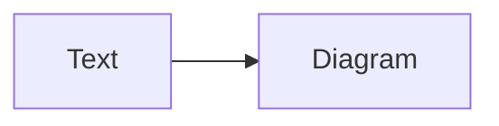

# DSH — Tengo dislexia

> Un diagrama en lugar de un muro de texto, dibujado donde estaba el texto.

## Qué hace

DeepSeek Harness ya dibuja Markdown en el chat. Este complemento añade una sola cosa: cuando una respuesta trae un bloque de código `mermaid`, el chat lo dibuja como diagrama ahí mismo, dentro del mensaje y en el hilo de la conversación. No se abre una ventana al lado ni se cambia a un panel lateral.

El bloque de código no se consume: sigue en el mensaje como texto, de modo que se puede copiar, reenviar y leer cuando este complemento ya no esté (la búsqueda no está verificada: ver los E-GAPS de la feature 001, G7).

## Por qué está construido así

- **El texto es el registro.** Cada dibujo se hace desde el bloque de código al mostrarlo, así que nada vive solo como píxeles. Desactiva el complemento y la conversación sigue completa.
- **Dentro del mensaje, no al lado.** Una ventana de vista previa corta el hilo de lectura: pierdes la línea en la que estabas.
- **El complemento pide un dibujo cuando un dibujo es más fácil.** Cuando un diagrama hace que una respuesta se siga mejor que un párrafo, ahora se lo indica al asistente y deja texto solo para lo que la imagen no puede mostrar. En Ajustes → General hay un interruptor; al desactivarlo, el complemento vuelve a limitarse a dibujar.
- **No se da nada por supuesto de tu equipo.** El motor de dibujo viene incluido, el complemento funciona sin conexión y no exige nada al anfitrión.

## Qué obtienes

- Diagramas en su sitio para bloques `mermaid`: flujo, secuencia, clases, estados, ER, mapas mentales, líneas de tiempo y otros tipos que admite el motor; la comprobación estática muestrea estos siete y el arnés de navegador solo dibuja los dos primeros (los demás no están probados, véanse los E-GAPS de la feature 001, G21).
- **Mostrar el código** y **Copiar el código** bajo cada dibujo: el texto detrás de la imagen queda a un clic.
- Mientras una respuesta se está generando, el bloque sigue siendo un bloque; el dibujo aparece cuando el bloque está completo.
- Un bloque que no se puede analizar muestra el código original y una línea con el motivo; nunca un marco vacío.
- Los colores y las fuentes siguen el tema de la interfaz, y el cambio de tema se recoge sin recargar.
- En un teléfono o una ventana estrecha el dibujo se recompone al ancho de la columna y el zoom ocurre dentro del dibujo, así que la página nunca se desplaza en horizontal.
- Ocho idiomas de interfaz, los mismos que incluye DeepSeek Harness.
- Nada se descarga en tiempo de ejecución: el motor está dentro del complemento.

## Datos y privacidad

- El complemento no hace ninguna petición de red en tiempo de ejecución; el motor de dibujo viene empaquetado dentro de `client.js`.
- No recoge nada ni envía nada a ningún sitio.
- Solo lee el texto del bloque de código `mermaid` que ya se muestra en tu página, y solo escribe el diagrama dentro de esa página.
- El botón **Copiar el código** usa el portapapeles de tu navegador; nada sale de la página.
- No se añade nada al historial de la sesión: el diagrama es una representación visual, no un objeto guardado (el lado de máquina real no está verificado: ver los E-GAPS de la feature 001, G12).

## Cómo verificarlo

Requisitos: Node.js 22 o superior, y Chrome/Chromium para las comprobaciones en navegador.

- `node verify/check-bundle.mjs` — comprobaciones estáticas y de motor del paquete distribuido (manifiesto, ausencia de llamadas de red, ausencia de puerta de versión, el motor incluido, ocho idiomas de interfaz, siete diagramas de ejemplo). Imprime una línea por comprobación y termina con código distinto de cero si falla.
- `node verify/run-harness.mjs` — ejecuta las comprobaciones en navegador con Chrome sin cabeza sobre `verify/harness/index.html` (dibujo, ocho idiomas, anfitriones hostiles, diagramas rotos, copia, columna estrecha de 360 px, colores del tema). Define `DSH_DYSLEXIA_CHROME` apuntando a un ejecutable de Chrome concreto si falla la detección automática.

Ambos comandos están en el repositorio, de modo que lo afirmado en este archivo puede volver a comprobarse en cualquier momento; son también los que ejecuta CI antes de publicar.

## Límites conocidos

Los identificadores `G…` remiten a los E-GAPS de la feature 001, en `specs/001-mermaid-fence-render/evidence/verification.md`.

- **Verificado aquí:** las comprobaciones en máquina real que siguen siendo válidas son las del plugin `0.1.31` y `0.1.32`; las filas antiguas de `0.1.2` ya no se trasladan tras los cambios de renderizado de `0.1.3`–`0.1.31`. La evidencia de esta versión llega al nivel de fixture para la ventana de escritorio, más una observación real en la superficie web (plugin `0.2.8`: la etiqueta y la ayuda de la fila, el interruptor, un clic que escribe el `cordis.patch.yml` del perfil y el valor que sobrevive a un reinicio — ver E-LIVE de la feature 002). Sin probar: el interruptor en una ventana de **escritorio**, el diseño estrecho en ocho idiomas y cualquier comparación de píxeles con las filas del anfitrión. Las páginas del complemento en los demás idiomas siguen sin verse (ver los E-GAPS de la feature 001, G13).
- **Probable, pero no demostrado en tu equipo:** otras versiones de DSH; otros navegadores basados en Chromium; las mismas comprobaciones en dispositivos móviles (la disposición está verificada en un área de visualización de 360 px en un navegador de escritorio, no en un teléfono físico); diagramas muy grandes (hay límites: 24 KiB de código fuente, 2 MiB de salida dibujada y 400 aristas; más allá de eso vuelve al bloque de código).
- **No realizado:** no se ha ensayado ninguna actualización de DSH (véanse los E-GAPS de la feature 001, G1); los diagramas no se dibujan mientras un mensaje sigue transmitiéndose; solo se tratan bloques ` ```mermaid ` (no otros lenguajes de bloque de código).

## Instalación

Instala el paquete `@jiezhengj/dsh-dyslexia` en tu perfil de DeepSeek Harness (página de complementos); dibuja figuras en la conversación; el renderizador se comprobó en vivo con el plugin `0.1.31` y `0.1.32`, y el interruptor aún no se ha operado en una ventana de **escritorio** (en la superficie web se le ha visto funcionar, E-LIVE de la feature 002) (ver los E-GAPS de la feature 002, G1/G6). La desinstalación surtirá efecto tras reiniciar la aplicación: una ventana abierta sigue mostrando la figura y sus dos botones ya cargados, y el historial no necesita cambios (ver los E-GAPS de la feature 001, G24①). Activar y desactivar pasan por el mecanismo de complementos del anfitrión sin tocar ningún archivo de configuración, pero **esos dos pasos no se han observado por separado** (véanse los E-GAPS de la feature 001, G20). Al cambiar de versión hay que reiniciar la aplicación para cargar el nuevo código de cliente. En npm: https://www.npmjs.com/package/@jiezhengj/dsh-dyslexia

## Ejemplo

Una respuesta contiene este bloque y el chat lo muestra como dibujo:



## Desinstalación y compatibilidad

- Desinstalar no modifica ninguna conversación anterior, pero surtirá efecto al reiniciar la aplicación: hasta entonces una ventana abierta sigue mostrando las figuras y sus dos botones ya cargados; tras el reinicio, los dibujos vuelven a ser los bloques de código de los que salieron, legibles.
- El complemento no declara puerta de versión ni paquete anfitrión obligatorio, así que ninguna comprobación de versión impide el arranque; una actualización real del anfitrión no se ha ensayado (véanse los E-GAPS de la feature 001, G1). Si el anfitrión cambia de forma, el complemento se aparta y se muestra el bloque de código original.

## Licencia

MIT. El motor de dibujo incluido, Pele 1.13.0, también es MIT; véase `THIRD-PARTY-NOTICES.md`.

Código fuente: https://github.com/jiezhengj/DSH-Dyslexia

Otros idiomas: [English](README.en.md) · [简体中文](README.zh.md) · [日本語](README.ja.md) · [Français](README.fr.md) · [Deutsch](README.de.md) · [Русский](README.ru.md) · [Português](README.pt.md)
