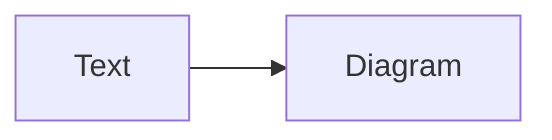

# DSH Diagramas legibles

> Un diagrama en lugar de un muro de texto, dibujado donde estaba el texto.

## Qué hace

DeepSeek Harness ya dibuja Markdown en el chat. Este complemento añade una sola cosa: cuando una respuesta trae un bloque de código `mermaid`, el chat lo dibuja como diagrama ahí mismo, dentro del mensaje y en el hilo de la conversación. No se abre una ventana al lado ni se cambia a un panel lateral.

El bloque de código no se consume: sigue en el mensaje como texto, de modo que se puede copiar, buscar, reenviar y leer cuando este complemento ya no esté.

## Por qué está construido así

- **El texto es el registro.** Cada dibujo se hace desde el bloque de código al mostrarlo, así que nada vive solo como píxeles. Desactiva el complemento y la conversación sigue completa.
- **Dentro del mensaje, no al lado.** Una ventana de vista previa corta el hilo de lectura: pierdes la línea en la que estabas.
- **La capacidad es del complemento, la preferencia es tuya.** El complemento solo dice que aquí aparecen dibujos. Si el asistente debe dibujar es instrucción tuya, en tu propio `AGENTS.md`.
- **No se da nada por supuesto de tu equipo.** El motor de dibujo viene incluido, el complemento funciona sin conexión y no exige nada al anfitrión.

## Qué obtienes

- Diagramas en su sitio para bloques `mermaid`: flujo, secuencia, clases, estados, ER, mapas mentales, líneas de tiempo y los demás tipos de Mermaid 12.1.
- **Mostrar el código** y **Copiar el código** bajo cada dibujo: el texto detrás de la imagen queda a un clic.
- Mientras una respuesta se está generando, el bloque sigue siendo un bloque; el dibujo aparece cuando el bloque está completo.
- Un bloque que no se puede analizar muestra el código original y una línea con el motivo; nunca un marco vacío.
- Los colores y las fuentes siguen el tema de la interfaz, y el cambio de tema se recoge sin recargar.
- En un teléfono o una ventana estrecha el dibujo se recompone al ancho de la columna y el zoom ocurre dentro del dibujo, así que la página nunca se desplaza en horizontal.
- Ocho idiomas de interfaz, los mismos que incluye DeepSeek Harness.
- Nada se descarga en tiempo de ejecución: el motor está dentro del complemento.

## Instalación

Instala el paquete `@jiezhengj/dsh-dyslexia` en tu perfil de DeepSeek Harness (página de complementos) y reinicia la aplicación. En npm: https://www.npmjs.com/package/@jiezhengj/dsh-dyslexia

## Ejemplo

Una respuesta contiene este bloque y el chat lo muestra como dibujo:

## Desinstalación y compatibilidad

- Desinstalar mantiene intactas las conversaciones anteriores: los dibujos vuelven a ser los bloques de código de los que salieron, legibles y buscables.
- El complemento no declara puerta de versión ni paquete anfitrión obligatorio, así que una actualización del anfitrión no puede impedir que la aplicación arranque; si el anfitrión cambia de forma, el complemento se aparta y se muestra el bloque de código original.

## Licencia

MIT. El motor de dibujo incluido, Pele 1.13.0, también es MIT; véase `THIRD-PARTY-NOTICES.md`.

Código fuente: https://github.com/jiezhengj/DSH-Dyslexia

Otros idiomas: [English](README.en.md) · [简体中文](README.zh.md) · [日本語](README.ja.md) · [Français](README.fr.md) · [Deutsch](README.de.md) · [Русский](README.ru.md) · [Português](README.pt.md)
