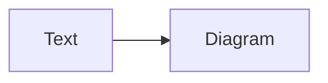

# DSH Schémas lisibles

> Un schéma au lieu d’un mur de texte, dessiné là où était le texte.

## Ce qu’il fait

DeepSeek Harness affiche déjà le Markdown dans la discussion. Ce greffon n’ajoute qu’une chose : quand une réponse contient un bloc de code `mermaid`, la discussion le dessine en schéma à cet endroit, dans le message et dans le fil de la conversation. Aucune fenêtre ne s’ouvre à côté, aucun panneau latéral ne s’affiche.

Le bloc de code n’est jamais consommé. Il reste le texte du message : on peut le copier, le transmettre et le lire une fois ce greffon retiré (la recherche n’est pas vérifiée : voir G7).

## Pourquoi cette construction

- **Le texte est la trace.** Chaque schéma est refait à partir du bloc de code au moment de l’afficher : rien n’existe uniquement en pixels. Désactivez le greffon, la conversation reste complète.
- **Dans le message, pas à côté.** Une fenêtre d’aperçu coupe le fil de lecture : on perd la ligne où l’on était.
- **La capacité au greffon, la préférence à vous.** Le greffon dit seulement que des schémas apparaissent ici. Que l’assistant doive dessiner relève de votre choix, et il fonctionne sans modifier aucun fichier de consignes.
- **Rien n’est supposé de votre machine.** Le moteur de dessin est embarqué, le greffon fonctionne hors ligne et n’exige rien de l’hôte.

## Ce que vous obtenez

- Des schémas à leur place pour les blocs `mermaid` : organigramme, séquence, classes, états, ER, carte mentale, chronologie et d’autres types que le moteur prend en charge ; le harnais n’exerce que ces sept (les autres ne sont pas testés, voir G21).
- **Afficher la source** et **Copier la source** sous chaque schéma : le texte derrière l’image est à un clic.
- Pendant la génération d’une réponse, le bloc reste un bloc ; le schéma apparaît quand le bloc est complet.
- Un bloc illisible affiche le code d’origine et une ligne indiquant la raison, jamais un cadre vide.
- Couleurs et polices suivent le thème de l’interface, et un changement de thème est pris en compte sans rechargement.
- Sur un téléphone ou dans une fenêtre étroite, le schéma se recompose à la largeur de la colonne et le zoom reste à l’intérieur du schéma : la page ne défile jamais horizontalement.
- Huit langues d’interface, les mêmes que celles livrées avec DeepSeek Harness.
- Aucun téléchargement à l’exécution : le moteur est dans le greffon.

## Données et confidentialité

- Le greffon n’effectue aucune requête réseau à l’exécution ; le moteur de dessin est embarqué dans `client.js`.
- Il ne collecte rien et n’envoie rien nulle part.
- Il lit uniquement le texte du bloc de code `mermaid` déjà affiché dans votre page, et il n’écrit que le schéma dans cette page.
- Le bouton **Copier la source** utilise le presse-papiers de votre navigateur ; rien ne quitte la page.
- Rien n’est ajouté à l’historique de votre session : le schéma est un rendu, pas un objet stocké.

## Comment vérifier

Prérequis : Node.js 22 ou plus récent, et Chrome/Chromium pour les vérifications dans le navigateur.

- `node verify/check-bundle.mjs` — vérifications statiques et du moteur sur le paquet livré (manifeste, aucun appel réseau, aucun seuil de version, moteur embarqué, huit langues d’interface, schémas d’exemple pour chaque type pris en charge). Affiche une ligne par contrôle et sort avec un code non nul en cas d’échec.
- `node verify/run-harness.mjs` — exécute les contrôles navigateur dans Chrome sans tête sur `verify/harness/index.html` (dessin, huit langues, hôtes hostiles, schémas cassés, copie, colonne étroite de 360 px, couleurs du thème). Définissez `DSH_DYSLEXIA_CHROME` vers un exécutable Chrome précis si la détection automatique échoue.

Les deux commandes sont dans le dépôt, si bien que ce qui est affirmé dans ce fichier peut être revérifié à tout moment ; ce sont aussi celles que l’intégration continue exécute avant publication.

## Limites connues

- **Vérifié ici :** dessin dans la discussion vérifié dans DSH bureau `0.2.2-rc.5` (extension `0.1.2`, la vérification sur appareil réel ne couvre que la page de documentation en chinois) ; repli des libellés vérifié ; repli à la désinstallation et réinstallation vérifiés ; huit langues d’interface vérifiées dans le harnais sans interface ; colonne étroite de 360 px vérifiée.
- **Probable, mais non prouvé sur votre machine :** autres versions de DSH ; autres navigateurs basés sur Chromium ; les mêmes vérifications sur appareils mobiles (la mise en page est vérifiée dans une fenêtre d’affichage de 360 px d’un navigateur de bureau, pas sur un téléphone physique) ; très grands schémas (il existe des limites : 24 KiB de source, 2 MiB de sortie dessinée, 400 arêtes ; au-delà, il se replie sur le bloc de code).
- **Non effectué :** aucune mise à niveau de DSH n’a été répétée à ce jour (voir G1) ; les schémas ne sont pas dessinés tant qu’un message est encore en cours de diffusion ; seuls les blocs ` ```mermaid ` sont pris en charge (pas les autres langages de bloc de code).

## Installation

Installez le paquet `@jiezhengj/dsh-dyslexia` dans votre profil DeepSeek Harness (page des greffons) ; il dessine les figures dans la conversation dès son installation (vérifié sur une machine réelle). La désinstallation a été observée sur une interface en cours d'exécution : la figure et ses boutons disparaissent, le message redevient son bloc de code d'origine et l'historique n'a pas besoin d'être modifié. L'activation et la désactivation passent par le mécanisme de greffons de l'hôte sans toucher à aucun fichier de configuration, mais **ces deux étapes n'ont pas été observées séparément** (voir G20). Changer de version exige un redémarrage pour charger le nouveau code client. Sur npm : https://www.npmjs.com/package/@jiezhengj/dsh-dyslexia

## Exemple

Une réponse contient ce bloc, et la discussion l’affiche en schéma :



## Désinstallation et compatibilité

- La désinstallation laisse intactes toutes les conversations passées : les anciens schémas redeviennent les blocs de code dont ils venaient, lisibles.
- Le greffon ne déclare ni seuil de version ni paquet hôte obligatoire : aucun contrôle de version ne peut donc refuser le démarrage ; une mise à jour réelle de l’hôte n’a pas été répétée (voir G1). si l’hôte change de forme, le greffon s’efface et le bloc de code d’origine est affiché.

## Licence

MIT. Le moteur de dessin embarqué Pele 1.13.0 est aussi sous MIT ; voir `THIRD-PARTY-NOTICES.md`.

Code source: https://github.com/jiezhengj/DSH-Dyslexia

Autres langues: [English](README.en.md) · [简体中文](README.zh.md) · [日本語](README.ja.md) · [Español](README.es.md) · [Deutsch](README.de.md) · [Русский](README.ru.md) · [Português](README.pt.md)
