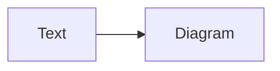

# DSH 図で読む

> 長い文章の代わりに一枚の図を——文章があった場所に描きます。

## できること

DeepSeek Harness はもともとチャットで Markdown を描画します。このプラグインが足すのは一点だけです。返信に `mermaid` コードブロックがあると、チャットはその場で図として描きます。メッセージの中、会話の流れの中に描かれ、横にウィンドウも開かず、サイドパネルにも切り替わりません。

コードブロックは消費されません。メッセージのテキストとして残るので、コピーでき、検索でき、転送でき、このプラグインを外した後でも読めます。

## この作りにした理由

- **テキストこそが記録です。** 図は表示のたびにコードブロックから作られるので、ピクセルにしか存在しない内容はありません。プラグインを切っても会話は完全なままです。
- **図はメッセージの中に。** 別のプレビューウィンドウは読む流れを切ります。どこまで読んだかを見失います。
- **能力はプラグイン、好みはあなたに。** プラグインは「ここに図が出る」と述べるだけです。図で表すかどうかは、あなたの `AGENTS.md` に書く好みです。
- **あなたの環境を仮定しません。** 描画エンジンは同梱され、実行時にネットワークを使わず、ホストに何も要求しません。

## 得られるもの

- `mermaid` コードブロックがその場で図に：フローチャート、シーケンス、クラス、状態、ER、マインドマップ、タイムライン、その他 Mermaid 12.1 の図種。
- 図の下に**ソースを表示**と**ソースをコピー**。図の背景にあるテキストは常にワンクリック先です。
- 返信がストリーミング中はコードブロックのまま。書き終わってから図になります。
- 解析できないブロックは、元のコードブロックと理由の一行を表示します。空の枠にはなりません。
- 色とフォントは画面テーマに従い、テーマ切り替えは再読み込みなしで反映されます。
- スマートフォンや狭いウィンドウでは列幅に合わせて組み替わり、拡大は図の中だけで起こるので、ページが横に流れません。
- インターフェース言語は 8 種類。DeepSeek Harness が同梱するものと同じです。
- 実行時の取得はありません。エンジンはプラグインの中にあります。

## インストール

DeepSeek Harness のプロファイル（プラグイン画面）に `@jiezhengj/dsh-dyslexia` をインストールし、アプリを再起動してください。npm: https://www.npmjs.com/package/@jiezhengj/dsh-dyslexia

## 例

返信に次のコードブロックがあると、チャットはそれを図として表示します。

## アンインストールと互換性

- アンインストールしても過去の会話はそのまま残ります。以前の図は元のコードブロックに戻り、読めて、検索できます。
- バージョンゲートも必須のホストパッケージも宣言していないため、ホストの更新でアプリが起動しなくなることはありません。ホストの形が変わった場合は、プラグインが身を引き、元のコードブロックを表示します。

## ライセンス

MIT。同梱の描画エンジン Pele 1.13.0 も MIT です（`THIRD-PARTY-NOTICES.md` を参照）。

ソース: https://github.com/jiezhengj/DSH-Dyslexia

他の言語: [English](README.en.md) · [简体中文](README.zh.md) · [Español](README.es.md) · [Français](README.fr.md) · [Deutsch](README.de.md) · [Русский](README.ru.md) · [Português](README.pt.md)
