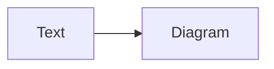

# DSH 私はディスレクシアです

> 長い文章の代わりに一枚の図を——文章があった場所に描きます。

## できること

DeepSeek Harness はもともとチャットで Markdown を描画します。このプラグインが足すのは一点だけです。返信に `mermaid` コードブロックがあると、チャットはその場で図として描きます。メッセージの中、会話の流れの中に描かれ、横にウィンドウも開かず、サイドパネルにも切り替わりません。

コードブロックは消費されません。メッセージのテキストとして残るので、コピーでき、転送でき、このプラグインを外した後でも読めます（検索は未検証: feature 001 の E-GAPS、G7）。

## この作りにした理由

- **テキストこそが記録です。** 図は表示のたびにコードブロックから作られるので、ピクセルにしか存在しない内容はありません。プラグインを切っても会話は完全なままです。
- **図はメッセージの中に。** 別のプレビューウィンドウは読む流れを切ります。どこまで読んだかを見失います。
- **図の方が分かりやすいときは、プラグインから図を求めます。** 段落より図の方が追いやすい場面では、その旨をアシスタントに伝え、図で示せない部分だけを文章に残します。設定 → 一般にスイッチがあり、切れば描画だけの動作に戻ります。
- **あなたの環境を仮定しません。** 描画エンジンは同梱され、実行時にネットワークを使わず、ホストに何も要求しません。

## 得られるもの

- `mermaid` コードブロックがその場で図に：フローチャート、シーケンス、クラス、状態、ER、マインドマップ、タイムライン。静的チェックはこの七種をサンプルとして扱い、ブラウザ側のフィクスチャは最初の二種のみを描きます（エンジンは他の図種にも対応していますが、未検証: feature 001 の E-GAPS、G21）。
- 図の下に**ソースを表示**と**ソースをコピー**。図の背景にあるテキストは常にワンクリック先です。
- 返信がストリーミング中はコードブロックのまま。書き終わってから図になります。
- 解析できないブロックは、元のコードブロックと理由の一行を表示します。空の枠にはなりません。
- 色とフォントは画面テーマに従い、テーマ切り替えは再読み込みなしで反映されます。
- スマートフォンや狭いウィンドウでは列幅に合わせて組み替わり、拡大は図の中だけで起こるので、ページが横に流れません。
- インターフェース言語は 8 種類。DeepSeek Harness が同梱するものと同じです。
- 実行時の取得はありません。エンジンはプラグインの中にあります。

## データとプライバシー

- このプラグインは実行時にネットワーク要求を一切行いません。描画エンジンは `client.js` の中に同梱されています。
- 何も収集せず、どこにも送信しません。
- 読み取るのはページにすでに表示されている `mermaid` コードブロックのテキストだけで、書き込むのもそのページへの図だけです。
- **ソースをコピー**ボタンはブラウザのクリップボードを使うだけで、ページの外には何も出ません。
- セッション履歴には何も追加されません。図は描画結果であり、保存されるオブジェクトではありません（実機では未確認: feature 001 の E-GAPS、G12）。

## 検証方法

必要な環境：Node.js 22 以上、およびブラウザ検証用の Chrome/Chromium。

- `node verify/check-bundle.mjs` — 配布バンドルの静的・エンジン検証（マニフェスト、ネットワーク呼び出しなし、バージョンゲートなし、同梱エンジン、8 種類のインターフェース言語、7 種のサンプル図）。検証ごとに 1 行出力し、失敗時は非ゼロで終了します。
- `node verify/run-harness.mjs` — ヘッドレス Chrome で `verify/harness/index.html` に対してブラウザ検証を実行します（描画、8 言語、想定外のホスト環境、壊れた図、コピー、360 px の狭い列、テーマ色）。自動検出に失敗する場合は、`DSH_DYSLEXIA_CHROME` で Chrome 実行ファイルを指定してください。

両方のコマンドはリポジトリに含まれているため、このファイルの記述はいつでも再確認できます。公開前に CI が実行するのも同じ検証です。

## 既知の制限

本文の `G…` は feature 001 の E-GAPS を指します（`specs/001-mermaid-fence-render/evidence/verification.md`）。

- **ここで検証済み：** 引き続き使える実機チェックはプラグイン `0.1.31` と `0.1.32` のものです。`0.1.3`–`0.1.31` で描画が変わったため、`0.1.2` の古い観察はもう移せません。このバージョンの証拠はデスクトップウィンドウについてはフィクスチャ止まりで、加えて Web 画面での実機観察が 1 回あります（プラグイン `0.2.8`：行のラベルと説明、スイッチ、クリックでプロファイルの `cordis.patch.yml` に書き込まれ、再起動後も値が保たれる — feature 002 の E-LIVE）。未検証：**デスクトップ**ウィンドウでのスイッチ操作、8 言語での狭いレイアウト、ホスト標準行とのピクセル比較。他の言語のプラグインページはまだ見ていません（feature 001 の E-GAPS、G13 参照）。
- **おそらく動作するが、あなたの環境では未実証：** 他の DSH バージョン、他の Chromium 系ブラウザ、モバイル端末での同様の確認（レイアウトはデスクトップブラウザの 360 px ビューポートで検証しており、実機のスマートフォンでは確認していません）、非常に大きな図（上限あり：ソース 24 KiB、描画出力 2 MiB、エッジ 400 本。超えるとコードブロックにフォールバックします）。
- **未実施：** DSH のアップグレードは一度も予行演習していません（feature 001 の E-GAPS、G1 参照）。メッセージがまだストリーミング中の間は図を描画しません。扱うのは ` ```mermaid ` フェンスのみで、他のフェンス言語は対象外です。

## インストール

DeepSeek Harness のプロファイル（プラグイン画面）に `@jiezhengj/dsh-dyslexia` をインストールすると、会話の中で図を描きます。描画エンジンはプラグイン `0.1.31` と `0.1.32` で実機確認済みですが、このスイッチはまだ実機ウィンドウで観察していません（feature 002 の E-GAPS、G1/G6 参照）。アンインストールはアプリの再起動後に反映されます。それまでは開いているウィンドウが読み込み済みの図と二つのボタンを表示し続け、履歴は変更されません（feature 001 の E-GAPS、G24① 参照）。有効化と無効化はホストのプラグイン機構が引き受け、設定ファイルには触れませんが、**この二つはまだ個別に実機で確認していません**（feature 001 の E-GAPS、G20 参照）。バージョンを変えた場合は、新しいクライアントコードを読み込むためにアプリの再起動が必要です。npm: https://www.npmjs.com/package/@jiezhengj/dsh-dyslexia

## 例

返信に次のコードブロックがあると、チャットはそれを図として表示します。



## アンインストールと互換性

- アンインストールは過去の会話を書き換えませんが、反映にはアプリの再起動が必要です。それまでは開いているウィンドウが読み込み済みの図と二つのボタンを表示し続け、再起動後に以前の図が元のコードブロックへ戻り、そのまま読めます。
- バージョンゲートも必須のホストパッケージも宣言していないため、バージョン検査で起動が拒否されることはありません。実際のホスト更新はまだ予行演習していません（feature 001 の E-GAPS、G1 参照）。ホストの形が変わった場合は、プラグインが身を引き、元のコードブロックを表示します。

## ライセンス

MIT。同梱の描画エンジン Pele 1.13.0 も MIT です（`THIRD-PARTY-NOTICES.md` を参照）。

ソース: https://github.com/jiezhengj/DSH-Dyslexia

他の言語: [English](README.en.md) · [简体中文](README.zh.md) · [Español](README.es.md) · [Français](README.fr.md) · [Deutsch](README.de.md) · [Русский](README.ru.md) · [Português](README.pt.md)
