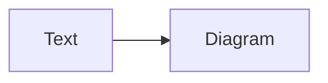

# DSH Diagramas legíveis

> Um diagrama no lugar de uma parede de texto — desenhado onde o texto estava.

## O que ele faz

O DeepSeek Harness já desenha Markdown no chat. Este plugin acrescenta uma coisa: quando uma resposta traz um bloco de código `mermaid`, o chat o desenha como diagrama ali mesmo, dentro da mensagem e no fluxo da conversa. Nenhuma janela abre ao lado, nada muda para um painel lateral.

O bloco de código nunca é consumido. Continua sendo o texto da mensagem: pode ser copiado, pesquisado, reenviado e lido depois que este plugin for removido.

## Por que foi feito assim

- **O texto é o registro.** Cada desenho é refeito a partir do bloco de código na hora de mostrar, então nada vive só como pixels. Desligue o plugin e a conversa continua completa.
- **Dentro da mensagem, não ao lado.** Uma janela de prévia quebra o fio da leitura: perde-se a linha em que se estava.
- **A capacidade é do plugin, a preferência é sua.** O plugin apenas diz que aqui aparecem desenhos. Se o assistente deve desenhar é instrução sua, no seu `AGENTS.md`.
- **Nada é presumido sobre a sua máquina.** O motor de desenho vem incluído, o plugin funciona sem rede e não exige nada do anfitrião.

## O que você recebe

- Diagramas no lugar para blocos `mermaid`: fluxo, sequência, classes, estados, ER, mapa mental, linha do tempo e os demais tipos do Mermaid 12.1.
- **Mostrar o código** e **Copiar o código** sob cada desenho: o texto por trás da imagem a um clique.
- Enquanto uma resposta é gerada, o bloco continua bloco; o desenho aparece quando o bloco está completo.
- Um bloco que não pode ser interpretado mostra o código original e uma linha com o motivo — nunca um quadro vazio.
- Cores e fontes seguem o tema da interface, e a troca de tema é captada sem recarregar.
- No celular ou numa janela estreita o desenho se reorganiza na largura da coluna e o zoom acontece dentro do desenho, então a página nunca rola na horizontal.
- Oito idiomas de interface, os mesmos que o DeepSeek Harness traz.
- Nada é buscado em tempo de execução: o motor está dentro do plugin.

## Instalação

Instale o pacote `@jiezhengj/dsh-dyslexia` no seu perfil do DeepSeek Harness (página de plugins) e reinicie o aplicativo. No npm: https://www.npmjs.com/package/@jiezhengj/dsh-dyslexia

## Exemplo

Uma resposta contém este bloco e o chat o mostra como desenho:

## Desinstalação e compatibilidade

- Desinstalar mantém intactas as conversas anteriores: os desenhos antigos voltam a ser os blocos de código de onde vieram, legíveis e pesquisáveis.
- O plugin não declara limite de versão nem pacote de anfitrião obrigatório, então uma atualização do anfitrião não pode impedir o aplicativo de iniciar; se a forma do anfitrião mudar, o plugin se retira e o bloco de código original é mostrado.

## Licença

MIT. O motor de desenho incluído, Pele 1.13.0, também é MIT; veja `THIRD-PARTY-NOTICES.md`.

Código-fonte: https://github.com/jiezhengj/DSH-Dyslexia

Outros idiomas: [English](README.en.md) · [简体中文](README.zh.md) · [日本語](README.ja.md) · [Español](README.es.md) · [Français](README.fr.md) · [Deutsch](README.de.md) · [Русский](README.ru.md)
