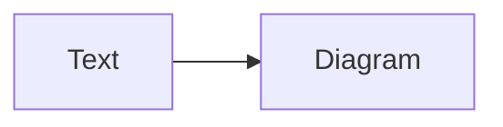

# DSH Diagramas legíveis

> Um diagrama no lugar de uma parede de texto — desenhado onde o texto estava.

## O que ele faz

O DeepSeek Harness já desenha Markdown no chat. Este plugin acrescenta uma coisa: quando uma resposta traz um bloco de código `mermaid`, o chat o desenha como diagrama ali mesmo, dentro da mensagem e no fluxo da conversa. Nenhuma janela abre ao lado, nada muda para um painel lateral.

O bloco de código nunca é consumido. Continua sendo o texto da mensagem: pode ser copiado, pesquisado, reenviado e lido depois que este plugin for removido.

## Por que foi feito assim

- **O texto é o registro.** Cada desenho é refeito a partir do bloco de código na hora de mostrar, então nada vive só como pixels. Desligue o plugin e a conversa continua completa.
- **Dentro da mensagem, não ao lado.** Uma janela de prévia quebra o fio da leitura: perde-se a linha em que se estava.
- **A capacidade é do plugin, a preferência é sua.** O plugin apenas diz que aqui aparecem desenhos. Se o assistente deve desenhar é decisão sua, e funciona sem editar nenhum arquivo de instruções.
- **Nada é presumido sobre a sua máquina.** O motor de desenho vem incluído, o plugin funciona sem rede e não exige nada do anfitrião.

## O que você recebe

- Diagramas no lugar para blocos `mermaid`: fluxo, sequência, classes, estados, ER, mapa mental, linha do tempo e os demais tipos do Mermaid 12.1.
- **Mostrar o código** e **Copiar o código** sob cada desenho: o texto por trás da imagem a um clique.
- Enquanto uma resposta é gerada, o bloco continua bloco; o desenho aparece quando o bloco está completo.
- Um bloco que não pode ser interpretado mostra o código original e uma linha com o motivo — nunca um quadro vazio.
- Cores e fontes seguem o tema da interface, e a troca de tema é captada sem recarregar.
- No celular ou numa janela estreita o desenho se reorganiza na largura da coluna e o zoom acontece dentro do desenho, então a página nunca rola na horizontal.
- Oito idiomas de interface, os mesmos que o DeepSeek Harness traz.
- Nada é buscado em tempo de execução: o motor está dentro do plugin.

## Dados e privacidade

- O plugin não faz nenhuma requisição de rede em tempo de execução; o motor de desenho vem empacotado dentro de `client.js`.
- Ele não coleta nada e não envia nada para lugar nenhum.
- Ele lê apenas o texto do bloco de código `mermaid` que já está exibido na sua página, e escreve apenas o diagrama nessa página.
- O botão **Copiar o código** usa a área de transferência do seu navegador; nada sai da página.
- Nada é adicionado ao histórico da sua sessão: o diagrama é uma renderização, não um objeto armazenado.

## Como verificar

Requisitos: Node.js 22 ou mais recente, e Chrome/Chromium para as verificações no navegador.

- `node verify/check-bundle.mjs` — verificações estáticas e do motor sobre o pacote entregue (manifesto, ausência de chamadas de rede, ausência de trava de versão, o motor empacotado, oito idiomas de interface, diagramas de exemplo de cada tipo suportado). Imprime uma linha por verificação e sai com código diferente de zero em caso de falha.
- `node verify/run-harness.mjs` — executa as verificações no navegador em Chrome headless contra `verify/harness/index.html` (desenho, oito idiomas, anfitriões hostis, diagramas quebrados, cópia, coluna estreita de 360 px, cores do tema). Defina `DSH_DYSLEXIA_CHROME` apontando para um executável específico do Chrome se a detecção automática falhar.

Os dois comandos estão no repositório, portanto o que este arquivo afirma pode ser conferido novamente a qualquer momento; são também os comandos que a CI executa antes de publicar.

## Limites conhecidos

- **Verificado aqui:** desenho no chat verificado no DSH desktop `0.2.2-rc.5` (plugin `0.1.2`, a verificação em equipamento real cobre apenas a página de documentação em chinês); fallback de rótulos verificado; fallback ao desinstalar e reinstalação verificados; oito idiomas de interface verificados no harness sem interface; coluna estreita de 360 px verificada.
- **Provável, mas não provado na sua máquina:** outras versões do DSH; outros navegadores baseados em Chromium; as mesmas verificações em dispositivos móveis (o layout foi verificado em uma viewport de 360 px em um navegador de desktop, não em um celular físico); diagramas muito grandes (há limites: 24 KiB de código-fonte, 2 MiB de saída desenhada, 400 arestas; acima disso ele volta ao bloco de código).
- **Não feito:** a atualização do DSH entre versões principais não foi ensaiada; os diagramas não são desenhados enquanto a mensagem ainda está sendo transmitida; apenas blocos ` ```mermaid ` são tratados (não outras linguagens de bloco de código).

## Instalação

Instale o pacote `@jiezhengj/dsh-dyslexia` no seu perfil do DeepSeek Harness (página de plugins) e reinicie o aplicativo ao trocar de versão. Ativar, desativar e desinstalar têm efeito imediato; trocar de versão exige reiniciar para carregar o novo código de cliente. No npm: https://www.npmjs.com/package/@jiezhengj/dsh-dyslexia

## Exemplo

Uma resposta contém este bloco e o chat o mostra como desenho:



## Desinstalação e compatibilidade

- Desinstalar mantém intactas as conversas anteriores: os desenhos antigos voltam a ser os blocos de código de onde vieram, legíveis e pesquisáveis.
- O plugin não declara limite de versão nem pacote de anfitrião obrigatório, então uma atualização do anfitrião não pode impedir o aplicativo de iniciar; se a forma do anfitrião mudar, o plugin se retira e o bloco de código original é mostrado.

## Licença

MIT. O motor de desenho incluído, Pele 1.13.0, também é MIT; veja `THIRD-PARTY-NOTICES.md`.

Código-fonte: https://github.com/jiezhengj/DSH-Dyslexia

Outros idiomas: [English](README.en.md) · [简体中文](README.zh.md) · [日本語](README.ja.md) · [Español](README.es.md) · [Français](README.fr.md) · [Deutsch](README.de.md) · [Русский](README.ru.md)
