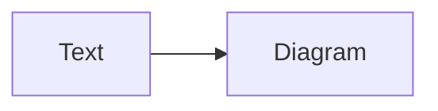

# DSH Читаемые диаграммы

> Диаграмма вместо стены текста — там, где был текст.

## Что он делает

DeepSeek Harness и так отображает Markdown в чате. Этот плагин добавляет одно: если в ответе есть блок кода `mermaid`, чат рисует его как диаграмму прямо здесь — внутри сообщения, в ходе разговора. Рядом не открывается окно и ничего не уезжает в боковую панель.

Блок кода не расходуется. Он остаётся текстом сообщения: его можно скопировать, найти поиском, переслать и прочитать после удаления плагина.

## Почему сделано именно так

- **Текст — это запись.** Каждая диаграмма строится из блока кода в момент показа, поэтому ничего не существует только в пикселях. Отключите плагин — разговор останется полным.
- **Внутри сообщения, а не рядом.** Окно предпросмотра рвёт нить чтения: теряется строка, на которой вы были.
- **Возможность — плагину, предпочтение — вам.** Плагин лишь сообщает, что здесь появляются диаграммы. Рисовать ли ассистенту — это ваша инструкция в вашем `AGENTS.md`.
- **О вашей машине ничего не предполагается.** Движок рисования вложен в пакет, плагин работает без сети и ничего не требует от хоста.

## Что вы получаете

- Диаграммы на месте блоков `mermaid`: блок-схема, последовательность, классы, состояния, ER, карта мыслей, шкала времени и остальные типы Mermaid 12.1.
- **Показать код** и **Копировать код** под каждой диаграммой: текст за картинкой в одном клике.
- Пока ответ печатается, блок остаётся блоком кода; диаграмма появляется, когда блок завершён.
- Блок, который не разбирается, показывает исходный код и одну строку с причиной — никогда пустую рамку.
- Цвета и шрифты следуют теме интерфейса, смена темы подхватывается без перезагрузки.
- На телефоне и в узком окне диаграмма перестраивается по ширине колонки, а масштаб меняется внутри диаграммы — страница не прокручивается вбок.
- Восемь языков интерфейса — те же, что поставляются с DeepSeek Harness.
- Во время работы ничего не загружается: движок внутри плагина.

## Установка

Установите пакет `@jiezhengj/dsh-dyslexia` в профиль DeepSeek Harness (страница плагинов) и перезапустите приложение. В npm: https://www.npmjs.com/package/@jiezhengj/dsh-dyslexia

## Пример

В ответе есть такой блок, и чат показывает его как картинку:

## Удаление и совместимость

- Удаление не ломает прошлые разговоры: прежние диаграммы снова становятся блоками кода, из которых появились, — читаемыми и доступными поиску.
- Плагин не объявляет ни порога версии, ни обязательного пакета хоста, поэтому обновление хоста не может помешать запуску приложения; если облик хоста изменится, плагин отступит и покажется исходный блок кода.

## Лицензия

MIT. Вложенный движок рисования Pele 1.13.0 также под MIT; см. `THIRD-PARTY-NOTICES.md`.

Исходный код: https://github.com/jiezhengj/DSH-Dyslexia

Другие языки: [English](README.en.md) · [简体中文](README.zh.md) · [日本語](README.ja.md) · [Español](README.es.md) · [Français](README.fr.md) · [Deutsch](README.de.md) · [Português](README.pt.md)
