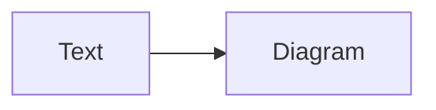

# DSH — У меня дислексия

> Диаграмма вместо стены текста — там, где был текст.

## Что он делает

DeepSeek Harness и так отображает Markdown в чате. Этот плагин добавляет одно: если в ответе есть блок кода `mermaid`, чат рисует его как диаграмму прямо здесь — внутри сообщения, в ходе разговора. Рядом не открывается окно и ничего не уезжает в боковую панель.

Блок кода не расходуется. Он остаётся текстом сообщения: его можно скопировать, переслать и прочитать после удаления плагина (поиск не проверялся: см. G7).

## Почему сделано именно так

- **Текст — это запись.** Каждая диаграмма строится из блока кода в момент показа, поэтому ничего не существует только в пикселях. Отключите плагин — разговор останется полным.
- **Внутри сообщения, а не рядом.** Окно предпросмотра рвёт нить чтения: теряется строка, на которой вы были.
- **Возможность — плагину, предпочтение — вам.** Плагин лишь сообщает, что здесь появляются диаграммы. Рисовать ли ассистенту — ваше решение, и для этого не нужно править файлы инструкций.
- **О вашей машине ничего не предполагается.** Движок рисования вложен в пакет, плагин работает без сети и ничего не требует от хоста.

## Что вы получаете

- Диаграммы на месте блоков `mermaid`: блок-схема, последовательность, классы, состояния, ER, карта мыслей, шкала времени и другие типы, которые поддерживает движок; статическая проверка охватывает эти семь, а браузерный тест рисует только первые две (остальные не проверены, см. G21).
- **Показать код** и **Копировать код** под каждой диаграммой: текст за картинкой в одном клике.
- Пока ответ печатается, блок остаётся блоком кода; диаграмма появляется, когда блок завершён.
- Блок, который не разбирается, показывает исходный код и одну строку с причиной — никогда пустую рамку.
- Цвета и шрифты следуют теме интерфейса, смена темы подхватывается без перезагрузки.
- На телефоне и в узком окне диаграмма перестраивается по ширине колонки, а масштаб меняется внутри диаграммы — страница не прокручивается вбок.
- Восемь языков интерфейса — те же, что поставляются с DeepSeek Harness.
- Во время работы ничего не загружается: движок внутри плагина.

## Данные и конфиденциальность

- Плагин не делает сетевых запросов во время работы; движок рисования вложен внутрь `client.js`.
- Он ничего не собирает и никуда ничего не отправляет.
- Он читает только текст блока кода `mermaid`, уже показанного на вашей странице, и записывает на эту страницу только саму диаграмму.
- Кнопка **Копировать код** использует буфер обмена вашего браузера; ничего не покидает страницу.
- В историю вашей сессии ничего не добавляется: диаграмма — это отрисовка, а не сохранённый объект (на реальной машине не проверено: см. G12).

## Как проверить

Требования: Node.js 22 или новее, а также Chrome/Chromium для браузерных проверок.

- `node verify/check-bundle.mjs` — статические проверки и проверки движка для поставляемого пакета (манифест, отсутствие сетевых вызовов, отсутствие порога версии, вложенный движок, восемь языков интерфейса, семь примеров диаграмм). Выводит по одной строке на проверку и завершается с ненулевым кодом при ошибке.
- `node verify/run-harness.mjs` — запускает браузерные проверки в headless Chrome на `verify/harness/index.html` (рисование, восемь языков, враждебные хосты, сломанные диаграммы, копирование, узкая колонка 360 px, цвета темы). Задайте `DSH_DYSLEXIA_CHROME` с путём к конкретному исполняемому файлу Chrome, если автоопределение не сработает.

Обе команды находятся в репозитории, поэтому утверждения в этом файле можно перепроверить в любой момент; те же проверки CI запускает перед публикацией.

## Известные ограничения

- **Проверено здесь:** отрисовка в чате проверена в настольном DSH `0.2.2-rc.5` (плагин `0.1.2`, проверка на реальном устройстве охватывает только страницу документации на китайском); откат подписей проверен; откат при удалении и повторная установка проверены; восемь языков интерфейса проверены в headless-тесте; узкая колонка 360 px проверена.
- **Вероятно, но не доказано на вашей машине:** другие версии DSH; другие браузеры на базе Chromium; те же проверки на мобильных устройствах (вёрстка проверена во вьюпорте 360 px настольного браузера, не на физическом телефоне); очень большие диаграммы (есть ограничения: исходник 24 KiB, вывод отрисовки 2 MiB, 400 рёбер; сверх этого показывается исходный блок кода).
- **Не делалось:** обновление DSH ни разу не репетировалось (см. G1); диаграммы не рисуются, пока сообщение ещё допечатывается (streaming); обрабатываются только блоки ` ```mermaid ` (не другие языки блоков кода).

## Установка

Установите пакет `@jiezhengj/dsh-dyslexia` в профиль DeepSeek Harness (страница плагинов); он рисует диаграммы в разговоре сразу после установки (проверено на реальной машине). Удаление наблюдалось в работающем интерфейсе: рисунок и кнопки исчезают, сообщение снова показывает исходный блок кода, а история не требует правок. Включение и отключение идут через плагинный механизм хоста и не трогают файлы конфигурации, но **эти два шага отдельно не наблюдались** (см. G20). При смене версии нужен перезапуск приложения, чтобы загрузился новый клиентский код. В npm: https://www.npmjs.com/package/@jiezhengj/dsh-dyslexia

## Пример

В ответе есть такой блок, и чат показывает его как картинку:



## Удаление и совместимость

- Удаление не ломает прошлые разговоры: прежние диаграммы снова становятся блоками кода, из которых появились, — читаемыми.  (действует после перезапуска приложения; открытое окно продолжает показывать уже загруженные рисунки)
- Плагин не объявляет ни порога версии, ни обязательного пакета хоста, поэтому ни одна проверка версии не может отказать в запуске; реальное обновление хоста не репетировалось (см. G1). если облик хоста изменится, плагин отступит и покажется исходный блок кода.

## Лицензия

MIT. Вложенный движок рисования Pele 1.13.0 также под MIT; см. `THIRD-PARTY-NOTICES.md`.

Исходный код: https://github.com/jiezhengj/DSH-Dyslexia

Другие языки: [English](README.en.md) · [简体中文](README.zh.md) · [日本語](README.ja.md) · [Español](README.es.md) · [Français](README.fr.md) · [Deutsch](README.de.md) · [Português](README.pt.md)
