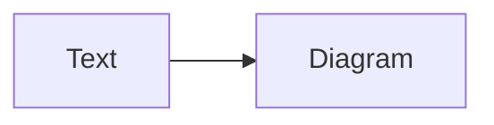

# DSH 图示阅读

> 用一张图代替一整段文字——就画在文字的位置上。

## 它做什么

DeepSeek Harness 本来就在聊天里渲染 Markdown。这个插件只加一件事：回复里出现 `mermaid` 代码块时，聊天就地把它画成图——就在消息里、在会话的行文里。不会在旁边开窗口，也不会切到侧栏。

代码块本身不会被消耗掉。它仍然是消息里的文本：可以复制、可以检索、可以转发，插件卸掉之后也照样能读。

## 为什么这样设计

- **文本才是记录。** 每张图显示时都从代码块重新生成，不存在只活在像素里的内容。关掉插件，会话依然完整。
- **画在图内，不画在图外。** 另开预览窗口会打断阅读线索：你会丢掉刚才读到哪一行。
- **能力归插件，偏好归你。** 插件只声明"这里会画图"；要不要用图表达，是你写在自己 `AGENTS.md` 里的偏好。
- **不假设你的机器。** 绘制引擎随插件打包，运行时不联网，也不要求宿主提供任何前置依赖。

## 你会得到什么

- `mermaid` 代码块就地成图：流程图、时序图、类图、状态图、ER 图、思维导图、时间线，以及 Mermaid 12.1 的其他图形类型。
- 每张图下方都有**查看源码**与**复制源码**，图背后的文本永远只差一次点击。
- 回复还在流式输出时，代码块保持原样；代码块写完了，图才出现。
- 语法有问题的代码块，显示原代码块加一行原因——不会留一个空框。
- 颜色与字体跟随界面主题，切换主题无需刷新。
- 手机上或窗口很窄时，图按栏宽重排，缩放只发生在图内，页面不会横向滚动。
- 八种界面语言，与 DeepSeek Harness 自带的语言一一对应。
- 运行时不抓取任何东西：引擎就在插件里。

## 安装

在 DeepSeek Harness 的插件页安装 `@jiezhengj/dsh-dyslexia`，然后重启应用。npm 上的包：https://www.npmjs.com/package/@jiezhengj/dsh-dyslexia。

## 示例

回复里有这样一个代码块，聊天会把它显示成图：

## 卸载与兼容性

- 卸载不会破坏任何历史会话：之前的图会变回它们来自的代码块，仍然可读、仍然可检索。
- 插件没有声明版本门，也没有要求任何宿主包，所以宿主升级不会让它开不了机；万一宿主接口变了，插件会主动退让，显示原本的代码块。

## 许可

MIT。随包内联的绘制引擎 Pele 1.13.0 同样是 MIT，见 `THIRD-PARTY-NOTICES.md`。

源码: https://github.com/jiezhengj/DSH-Dyslexia

其他语言: [English](README.en.md) · [日本語](README.ja.md) · [Español](README.es.md) · [Français](README.fr.md) · [Deutsch](README.de.md) · [Русский](README.ru.md) · [Português](README.pt.md)
