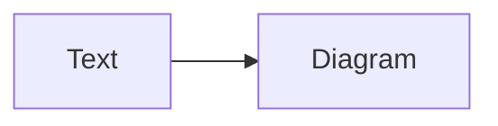

# DSH 我有阅读障碍

> 用一张图代替一整段文字——就画在文字的位置上。

## 它做什么

DeepSeek Harness 本来就在聊天里渲染 Markdown。这个插件只加一件事：回复里出现 `mermaid` 代码块时，聊天就地把它画成图——就在消息里、在会话的行文里。不会在旁边开窗口，也不会切到侧栏。

代码块本身不会被消耗掉。它仍然是消息里的文本：可以复制、可以转发，插件卸掉之后也照样能读（检索未取证，见 feature 001 的 E-GAPS 里的 G7）。

## 为什么这样设计

- **文本才是记录。** 每张图显示时都从代码块重新生成，不存在只活在像素里的内容。关掉插件，会话依然完整。
- **画在图内，不画在图外。** 另开预览窗口会打断阅读线索：你会丢掉刚才读到哪一行。
- **图更好懂时，插件会主动要一张图。** 当一张图比一段话更容易跟上时，插件现在会这样告诉助手，文字只留图讲不清的部分。设置 → 通用里有开关；关掉后插件就回到只负责渲染。
- **不假设你的机器。** 绘制引擎随插件打包，运行时不联网，也不要求宿主提供任何前置依赖。

## 你会得到什么

- `mermaid` 代码块就地成图：流程图、时序图、类图、状态图、ER 图、思维导图、时间线，以及引擎支持的其他图形类型；静态检查采样这七种，浏览器夹具只画了前两种（见 feature 001 的 E-GAPS 里的 G21）。
- 每张图下方都有**查看源码**与**复制源码**，图背后的文本永远只差一次点击。
- 回复还在流式输出时，代码块保持原样；代码块写完了，图才出现。
- 语法有问题的代码块，显示原代码块加一行原因——不会留一个空框。
- 颜色与字体跟随界面主题，切换主题无需刷新。
- 手机上或窗口很窄时，图按栏宽重排，缩放只发生在图内，页面不会横向滚动。
- 八种界面语言，与 DeepSeek Harness 自带的语言一一对应。
- 运行时不抓取任何东西：引擎就在插件里。

## 数据与隐私

- 插件在运行时不发起任何网络请求；绘制引擎内联打包在 `client.js` 中。
- 不收集任何信息，也不向任何地方发送数据。
- 只读取页面上已经显示出来的 `mermaid` 代码块文本，只把生成的图写回该页面。
- **复制源码**按钮只使用浏览器剪贴板；没有任何内容离开当前页面。
- 不会向会话历史写入任何内容：图只是界面渲染结果，不是保存的对象（真机未核对，见 feature 001 的 E-GAPS 里的 G12）。

## 验证方法

环境要求：Node.js 22 或更新版本，以及用于浏览器检查的 Chrome/Chromium。

- `node verify/check-bundle.mjs` — 对随包产物执行静态与引擎检查（manifest、无网络调用、无版本门、内联引擎、八种界面语言、七种图形的示例图）。每项检查打印一行，失败时以非零状态码退出。
- `node verify/run-harness.mjs` — 在无头 Chrome 中针对 `verify/harness/index.html` 运行浏览器检查（成图、八种语言、异常宿主环境、损坏的图形语法、复制、360 px 窄栏、主题颜色）。若自动探测失败，可设置 `DSH_DYSLEXIA_CHROME` 指向指定的 Chrome 可执行文件。

两条命令都在仓库中，可随时重新验证本文件所述内容；它们也是发布前 CI 运行的检查。

## 已知限制

文中的 `G…` 编号指 feature 001 的 E-GAPS，原文在 `specs/001-mermaid-fence-render/evidence/verification.md`。

- **已在此验证：** 仍可转移的真机检查来自插件 `0.1.31` 与 `0.1.32`；`0.1.3`–`0.1.31` 改过渲染之后，`0.1.2` 的旧观察不再转移；本版本的证据只到夹具级别。尚未测试：在真机窗口里操作开关、八种语言的窄栏布局、与宿主自带行的像素比对。其余语言的插件页仍未看过（见 feature 001 的 E-GAPS 里的 G13）。
- **大概率可用，但未在你的机器上实证：** 其他 DSH 版本；其他 Chromium 内核浏览器；移动设备上的同类测试（布局仅在桌面浏览器的 360 px 视口中验证，未在实体手机上测试）；超大图形（存在上限：源码 24 KiB、绘制输出 2 MiB、400 条边；超出后回退显示代码块）。
- **尚未完成：** 尚未演练任何一次 DSH 升级（见 feature 001 的 E-GAPS 里的 G1）；消息仍在流式输出时不会成图；只处理 ` ```mermaid ` 代码块（不处理其他语言标记的代码块）。

## 安装

把 DeepSeek Harness 的插件页装 `@jiezhengj/dsh-dyslexia`：装进 profile 之后会话里直接成图（真机已验证）。卸载要重启应用后才生效：打开着的窗口会继续显示已经画出的图与两个按钮，历史消息不用改（见 feature 001 的 E-GAPS 里的 G24①）；启用与停用由宿主的插件机制接管、不需要改任何配置，但**这两步还没有单独的真机观察**（见 feature 001 的 E-GAPS 里的 G20）。换版本要重启应用，才会加载新的客户端代码。npm 上的包：https://www.npmjs.com/package/@jiezhengj/dsh-dyslexia

## 示例

回复里有这样一个代码块，聊天会把它显示成图：



## 卸载与兼容性

- 卸载不会改写任何历史会话，但要重启应用后才生效：在此之前，打开着的窗口会继续显示已经加载的图与两个按钮；重启之后，之前的图才变回它们来自的代码块，仍然可读。
- 插件没有声明版本门，也没有要求任何宿主包，所以任何版本检查都不会拒绝启动；真实宿主升级尚未演练（见 feature 001 的 E-GAPS 里的 G1）。万一宿主接口变了，插件会主动退让，显示原本的代码块。

## 许可

MIT。随包内联的绘制引擎 Pele 1.13.0 同样是 MIT，见 `THIRD-PARTY-NOTICES.md`。

源码: https://github.com/jiezhengj/DSH-Dyslexia

其他语言: [English](README.en.md) · [日本語](README.ja.md) · [Español](README.es.md) · [Français](README.fr.md) · [Deutsch](README.de.md) · [Русский](README.ru.md) · [Português](README.pt.md)
