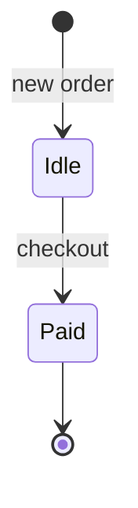

# 颜色是有含义的

图里的颜色不是装饰：形状决定角色，角色决定色相。想换颜色时，作者自己写的 `classDef` 或 `style` 优先，插件不会覆盖。

## 五个角色

按形状类（引擎写进 `g.pele-node.pele-shape-<形状>`）取色相，填充是把色相 18% 混进图底色，描边是把色相 60% 混进文字墨色，所以浅色与深色主题共用一套规则。

| 角色 | 形状 | 宿主色相 | 浅色填充 / 文字 | 深色填充 / 文字 |
| --- | --- | --- | --- | --- |
| 起止 start / end | `stadium` `circle` `odd` `sm-circ` `fr-circ` `dbl-circ` `cross-circ` `f-circ` | `--dsw-static-green-500` `#22c55e` | `#d7f5e2` · 16.20:1 | `#23402e` · 10.87:1 |
| 判断 decision | `diam` `hex` `bang` | `--dsw-static-amber-500` `#f59e0b` | `#fdeed3` · 16.47:1 | `#493920` · 10.63:1 |
| 数据 data | `cyl` `datastore` `folder` `bucket` `doc` `docs` `lin-doc` `tag-doc` `tag-rect` `st-rect` `win-pane` | `--dsw-static-violet-400` `#a78bfa` | `#efeafe` · 16.10:1 | `#3b364b` · 11.12:1 |
| 输入输出 input / output | `lean-r` `lean-l` `trap-b` `trap-t` `curv-trap` `person` `browser` `cloud` | `--dsw-alias-link` `#4176e6` | `#dde6fb` · 15.13:1 | `#333b4b` · 10.73:1 |
| 处理 step | `rect` `rounded` `fr-rect` `notch-rect` `lin-rect` `console` `delay` `div-rect` `tri` `flip-tri` `sl-rect` `bow-rect` `brace` `brace-r` `braces` `bolt` `fork` `hourglass` `h-cyl` `lin-cyl` `notch-pent` `flag` `text` | `--dsw-static-neutral-bluish-400` `#adb2b8` | `#f0f1f2` · 16.73:1 | `#3c3d3f` · 10.44:1 |

描边对画布：浅色 4.87–8.05:1，深色 8.71–10.02:1。

这张表是**引擎自己的 53 个形状**，一个不漏：形状名单不是手写的，是从 `vendor/pele/pele.global.js` 的形状表里读出来再和样式表比对（`verify/check-bundle.mjs` 的 `every shape class has a role rule of its own`）。引擎哪天多出一个形状，构建就会红，不会等到聊天里出现一个灰方块才发现。

## 八个系列色

饼图、甘特条、时间线、思维导图与柱状图不按形状取色，它们按顺序读 `--pele-series-1..8`。引擎会用画布色给这些填充区写标签，所以每个系列色都 55% 混进文字墨色：浅色主题得到深色调，深色主题得到浅色调，两边都能读。

| 序号 | 宿主色相 | 浅色 | 深色调 · 画布墨 |
| --- | --- | --- | --- |
| 1 | `--dsw-alias-chart-messages` `#4d93f8` | `#2b4c7b` · 8.72:1 | `#acccfa` · 9.52:1 |
| 2 | `--dsw-static-green-500` `#22c55e` | `#186236` · 7.40:1 | `#98e2b4` · 10.39:1 |
| 3 | `--dsw-static-blue-400` `#60a5fa` | `#33547c` · 7.81:1 | `#b4d4fb` · 10.26:1 |
| 4 | `--dsw-static-amber-500` `#f59e0b` | `#765011` · 7.13:1 | `#f7d18f` · 10.80:1 |
| 5 | `--dsw-static-deepseek-400` `#7aaaff` | `#3f567e` · 7.39:1 | `#c0d6fd` · 10.67:1 |
| 6 | `--dsw-static-red-500` `#ef4444` | `#74282a` · 10.11:1 | `#f5a8a9` · 8.26:1 |
| 7 | `--dsw-static-violet-400` `#a78bfa` | `#53487c` · 8.12:1 | `#d4c8fb` · 10.06:1 |
| 8 | `--dsw-static-neutral-bluish-400` `#adb2b8` | `#56595e` · 6.99:1 | `#d7dadd` · 11.15:1 |

## 不是流程图的时候

`classDiagram`、`stateDiagram-v2`、`erDiagram`、`sequenceDiagram`、`kanban`、`journey`、`requirementDiagram`、`architecture-beta`、`C4Context`、`agentflow-beta`、`block-beta` 不画流程图形状，节点分别是类、状态、实体、参与者、卡片、任务、需求、服务、C4 元素、智能体步骤、块。它们的主体节点按"这是什么"取色：类/状态/实体/参与者/卡片/需求/树图节点是**数据**紫，C4 的人与块图的节点按形状落到起止或处理，起止符（状态机的 `[*]`）是**起止**绿。一张状态机因此是绿端点 + 紫状态，而不是一屏灰方块。

实测（同样来自 `verify/host-tokens.json`）：

| 节点 | 浅色 | 深色 |
| --- | --- | --- |
| `pele-state` 填充 | `#efeafe` · 文字 16.10:1 | `#3b364b` · 文字 11.12:1 |
| `pele-state` 描边对画布 | 5.86:1 | 10.11:1 |
| `pele-state-start` / `-end` 填充 | `#d7f5e2` · 描边 5.18:1 | `#23402e` · 描边 10.71:1 |

饼图、时间线、甘特、多系列图用的是八个**系列色**（上一节），与角色色互不冲突：系列色区分"第几条数据"，角色色区分"这是什么"。

树图（`treemap`）的叶子是数据本身，引擎直接拿 `--pele-series-N` 铺满，标签用画布色写，所以叶子保持系列色、不再叠角色色——插件故意**不**接管 `.pele-leaf`。

`sankey-beta`、`packet-beta`、`radar-beta`、`quadrantChart`、`gitGraph`、`info`、`cynefin-beta`、`ishikawa` 这些没有"一种东西一个框"的图种，看的是线、字与少量强调色：线用 `--pele-line`（≥3:1）、字用墨色（≥4.5:1），雷达的蛛网与图表的网格按装饰线处理（≥1.4:1，安静但存在）。

完整的 53 个形状与 12 个额外图种的实测图在 `specs/003-diagram-palette-contrast/evidence/all-shapes.png` 与 `all-types.png`。

## 作者优先

`classDef` 与行内 `style` 落在形状元素上，浏览器里行内样式永远压过插件的样式表，所以作者写 `classDef important fill:#dbeafe,stroke:#2563eb` 就是最终颜色。引擎会按填充深浅自动挑墨色，插件只负责把 `--pele-fg-on-light` / `--pele-fg-on-dark` 接到宿主令牌，保证这个墨色在两套主题里都读得出来。

## 数字从哪来

上表由 `verify/host-tokens.json`（宿主 0.2.2-rc.5）里的真实令牌算出，算法与 `src/client/styles.js` 的 `color-mix()` 相同；改主题、改宿主版本后，用 `node scripts/extract-host-tokens.mjs` 刷新快照，再用 `node scripts/build-evidence.mjs` 重新生成实测页 `specs/003-diagram-palette-contrast/evidence/shipped.html`。

## 图的宽度

柱状图（`xychart`）和甘特图按**栏目实际可用的宽度**绘制：宽窗口就画宽图，栏变宽变窄时会重画一次，不是把旧图拉伸。其它图种本来就按内容自适应，只会在超出栏目时被缩到栏宽以内。

所以一张 13 个类目的柱状图在宽窗口里会把 13 个类目名都画在柱脚下；窗口太窄放不下时，引擎会抽掉一部分类目名，而不是让它们互相压住。

作者不需要在代码里写宽度：插件会把框架的宽度交给引擎（`config.xyChart.width` / `config.gantt.useWidth`）。
